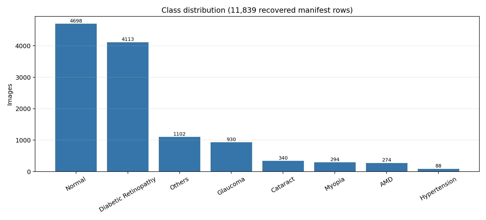
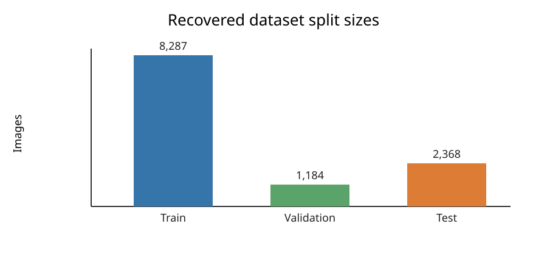
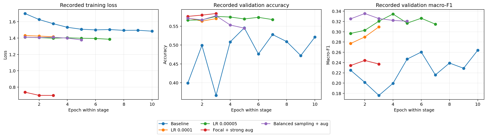
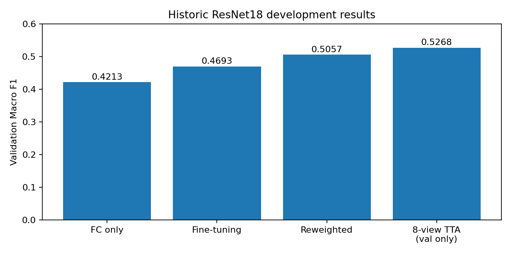
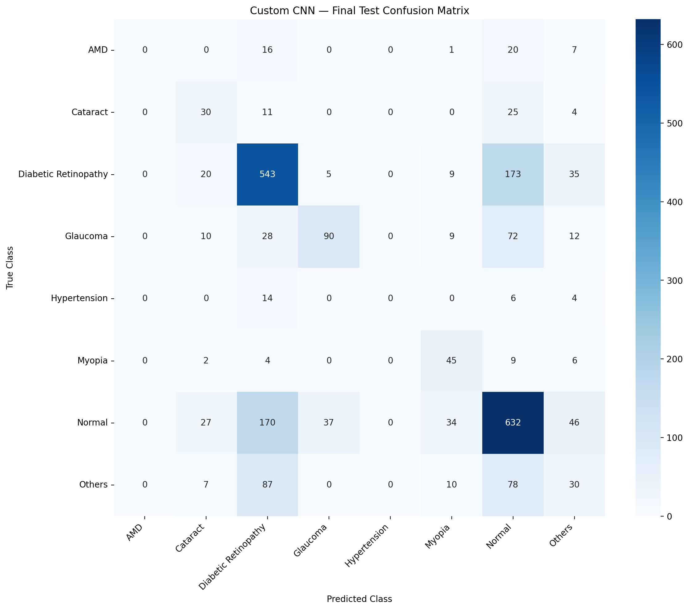
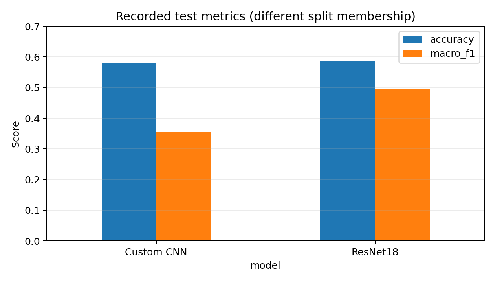
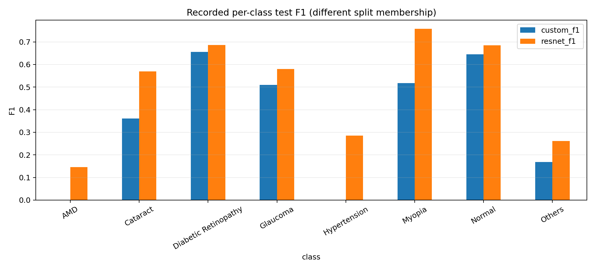
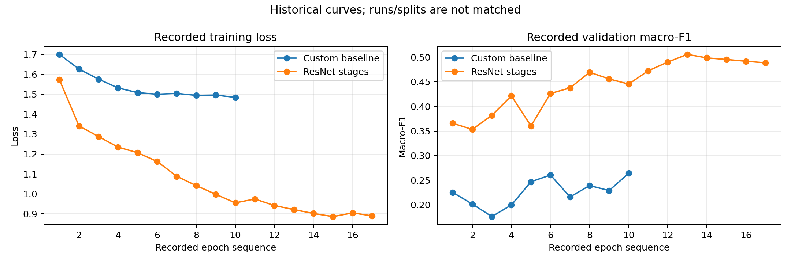

# Eye Disease Classification

University assignment submission for eight-class fundus-image classification using a Custom CNN and a fine-tuned ResNet18. All numbers and figures come from recovered experiment artifacts; no training was repeated while preparing this repository.

> Educational use only. These models are not clinical diagnostic systems.

## Notebooks and models

| Model | Notebook status | Saved model | Kaggle notebook |
|---|---|---|---|
| Custom CNN | [Reconstructed artifact report](Custom_CNN/notebooks/custom_cnn_reconstructed_artifact_report.ipynb); original complete training notebook missing | [Best recovered checkpoint](Custom_CNN/checkpoints/) | `KAGGLE_URL_NOT_RECOVERED — replace with verified Custom CNN URL` |
| ResNet18 | [Reconstructed workflow](ResNet18/notebooks/resnet18_full_reconstructed.ipynb), [original data fragment](ResNet18/source_notebooks/notebook_data_fragment.ipynb), and [original TTA fragment](ResNet18/source_notebooks/notebook_tta_fragment.ipynb) | [Model folder](ResNet18/models/) — checkpoint missing | `KAGGLE_URL_NOT_RECOVERED — replace with verified ResNet18 URL` |

No Kaggle URL was present in the supplied files, so none was invented. Reconstructed notebooks are supporting workflows/reports, not the original executed training run.

## Assignment workflow

### 1. Dataset inspection

The recovered manifests describe 11,839 images from ODIR5K, APTOS2019, ACRIMA, and ORIGA, labeled as AMD, Cataract, Diabetic Retinopathy, Glaucoma, Hypertension, Myopia, Normal, or Others. See [dataset analysis](Dataset_Analysis/README.md) and the [assignment PDF](docs/assignment.pdf).

### 2. Eight-class distribution

The dataset is strongly imbalanced: Normal has 4,698 images while Hypertension has 88.

### 3. Sample fundus images

The required eight genuine sample images are **missing** because the image dataset was not supplied. No medical images were fabricated. See [sample-image status](Dataset_Analysis/sample_images/README.md).

### 4. Preprocessing and splits

The recovered Custom CNN manifests contain 8,287 training, 1,184 validation, and 2,368 test rows. Exact original preprocessing code was not recovered. The reconstructed ResNet18 notebook documents a 224×224 normalized workflow, but its original split CSVs are missing.

### 5. Imbalance handling

The selected Custom CNN checkpoint records `balanced_sampling_and_augmentation`. The reconstructed ResNet18 workflow uses class-weighted cross-entropy. Exact original Custom CNN sampler, augmentation, and loss code is unavailable.

### 6. Custom CNN training

[Custom CNN artifacts](Custom_CNN/README.md) include the selected checkpoint, recorded training stages, test report, confusion matrix, and validation TTA summary.

### 7. ResNet18 fine-tuning

[ResNet18 artifacts](ResNet18/README.md) contain historical frozen-head, fine-tuning, and reweighted-stage metrics. The full notebook is reconstructed and the trained checkpoint is missing.

### 8. Model evaluation

| Model | Recorded evaluation | Accuracy | Macro F1 |
|---|---|---:|---:|
| Custom CNN | Test, no TTA, 2,368 samples | 0.5785 | 0.3571 |
| ResNet18 | Historical test, original inference, 2,368 samples | 0.5861 | 0.4965 |

Custom CNN [report](Custom_CNN/results/final_test/classification_report.csv) and [confusion matrix](Custom_CNN/results/final_test/final_confusion_matrix.png); ResNet18 [historical report](ResNet18/results/historic_test_classification_report.csv).

### 9. Comparison

The reports have different per-class supports, proving that their test memberships differ. Results are shown side by side for documentation, **not as a controlled head-to-head experiment**. Full tables and discussion are in [Comparison](Comparison/README.md).

### 10. Limitations

- Original complete Custom CNN training notebook missing.
- Original ResNet18 checkpoint and split CSVs missing.
- Exact Custom CNN preprocessing/training implementation missing.
- Genuine eight-class sample images missing.
- No measured inference latency or throughput for either model.
- Different test splits prevent a controlled model comparison.
- No verified Kaggle notebook URLs recovered.

See the [assignment requirement checklist](docs/requirements_checklist.md).
